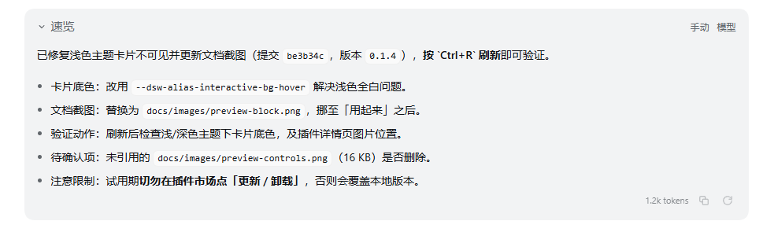

# Condensed view

Appends a 「速览」 block below each assistant reply: conclusion first, about a third of the original length, with numbers, code, paths, and commands kept verbatim. The rewrite runs beside the conversation—the main model's system prompt and context stay untouched.

## Using it

- **Manual (default)**: a reply long enough shows a single 「› 速览」 row. Click it to generate; nothing is spent until you click.
- **Automatic**: expand the block and switch to 「全部」 or 「本会话」 in the top-right corner. Automatic mode covers only replies written after the switch; opening an old session never backfills it. At most 2 rewrites run at once.
- **Model**: 「模型」 lists the providers and models configured in DSH. No model is bundled, and nothing is generated until you pick one.
- Folded, the block is one row: 「› 速览 · first sentence」. Expanded, the bottom-right corner shows the tokens this rewrite cost, copies the whole Markdown, and discards the result to redo it.

## When it appears

- A reply must have prose and be at least `minChars` (default 400) and at most `maxChars` (default 40000) characters long.
- Tool-only turns, turns without prose, and interrupted turns get no entry point; the Host decides with one local request that calls no model.

## Cost and boundaries

- Each generation is one model call. If the result exceeds the target length by 1.5×, the draft is condensed once more and both calls' tokens are shown.
- Results are cached per session, turn, and model: expanding again costs nothing, switching models regenerates.
- Only the reply already stored for this turn is sent to the model you picked. Nothing is uploaded elsewhere, the original reply is not modified, and the session log gains no events.

## Configuration

In the profile's `cordis.patch.yml`, under the `- id: interpreter` row's `config`; the model and mode you pick in the UI are written back to the same row.

| Key | Default | Meaning |
| --- | --- | --- |
| `minChars` | `400` | Replies shorter than this are skipped |
| `maxChars` | `40000` | Replies longer than this are skipped |
| `ratio` | `0.35` | Target length as a share of the original |
| `capChars` | `900` | Upper bound for the condensed length |
| `temperature` | `0.3` | Sampling temperature |
| `prompt` | built in | The rewrite instruction; change it to change the style |
