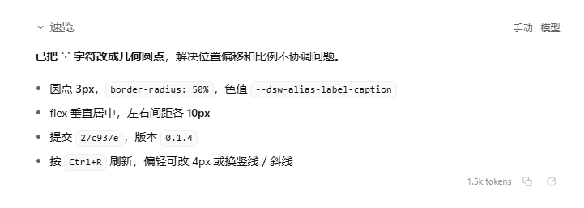

# 速览

在每条助手回答下方追加一块「速览」：结论先行，长度约为原文的三分之一，数字、代码、路径、命令原样保留。改写走旁路，主对话的系统提示词和上下文不变。

## 用起来

- **手动（默认）**：够长的回答下面只有一行「› 速览」，点一下才生成，不会自己花钱。
- **自动**：展开后在右上角切换「全部」或「本会话」。自动只处理切换之后新写出的回答，翻旧会话不会补跑；同一时间最多 2 条在跑。
- **选模型**：块内「模型」列出本机 DSH 已配置的 provider / model，插件不自带模型；没选之前不生成。
- 收起时只留一行「› 速览 · 结论句」。展开后右下角显示这条花掉的 tokens，可复制整段 Markdown，可丢弃结果重做。

## 什么时候出现

- 回答要有正文，且不短于 `minChars`（默认 400 字）、不长于 `maxChars`（默认 40000 字）。
- 纯工具轮次、没有正文的轮次、被中断的轮次不出现入口；判定在 Host 侧做，一次本地请求，不调模型。

## 费用与边界

- 每次生成是一次模型调用；结果超出目标长度 1.5 倍时会带草稿再压一遍，tokens 按两次相加。
- 结果按「会话 + 轮次 + 模型」缓存：重复展开不再计费，换模型会重新生成。
- 只把这一轮已落盘的回答发给所选模型，不向其他服务上传数据；原文不改，会话日志不新增事件。

## 配置

Profile 目录下 `cordis.patch.yml` 中 `- id: interpreter` 的 `config`；界面上选的模型和模式也写回这一行。

| 键 | 默认 | 说明 |
| --- | --- | --- |
| `minChars` | `400` | 短于此不整理 |
| `maxChars` | `40000` | 长于此不整理 |
| `ratio` | `0.35` | 目标长度占原文的比例 |
| `capChars` | `900` | 速览自身的字数上限 |
| `temperature` | `0.3` | 采样温度 |
| `prompt` | 内置 | 改写指令，改它换风格 |
